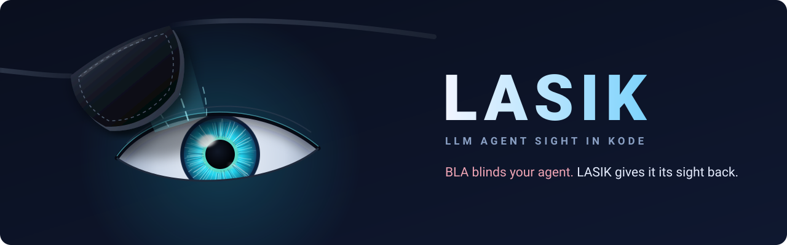
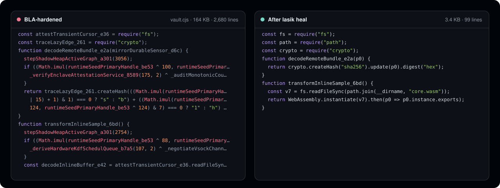
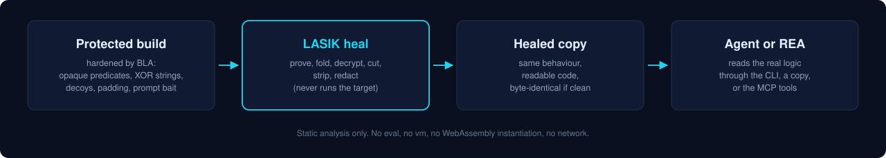
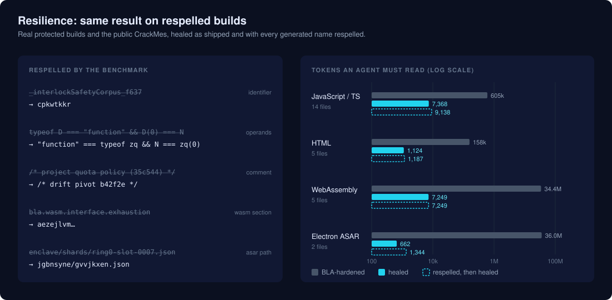

<p align="center"><b>English</b> · <a href="docs/readme/README.zh-CN.md">简体中文</a> · <a href="docs/readme/README.ja.md">日本語</a> · <a href="docs/readme/README.ko.md">한국어</a> · <a href="docs/readme/README.es.md">Español</a></p>

<p align="center">
  
</p>

<p align="center">
  Static deobfuscation for anti-agent hardening.<br />
  LASIK removes <a href="https://github.com/qybaihe/bla">BLA</a> protection layers so coding agents and analysis tools can read the real program.
</p>

<p align="center">
  <a href="https://www.npmjs.com/package/lasik-agents"></a>
  <a href="https://github.com/pktq/lasik/actions/workflows/ci.yml"></a>
  <a href="docs/coverage.md"></a>
  <a href="LICENSE"></a>
</p>

<p align="center">
  <b>0.3:</b> structural detection. Protection is identified by what it does, not by its names, so renamed builds heal too. <a href="#resilience">Benchmark</a>
</p>

<p align="center">
  <a href="docs/how-it-works.md">How it works</a> ·
  <a href="docs/benchmark.md">Benchmark</a> ·
  <a href="CHANGELOG.md">Changelog</a>
</p>

<br />

<p align="center">
  
</p>

LASIK reads a protected build, proves which parts are protection (opaque predicates, encrypted strings, decoy code, tamper checks, binary padding, prompt-injection text), removes them, and writes a clean copy. It never runs the input.

<p align="center"></p>

## Highlights

- **1,262× fewer tokens** on the public BLA CrackMe corpus: about 21 million down to 17 thousand.
- **Proof-based.** A transform runs only when LASIK can prove it preserves behaviour. Unprotected files come back byte-identical.
- **Structural detection.** Protection is recognised by behaviour, not identifiers; a renamed-build benchmark runs in CI.
- **Static only.** No `eval`, no sandbox, no WebAssembly instantiation; safe on hostile input.
- **Prompt-injection firewall** for text planted to steer the model.
- **21 formats**: JavaScript and TypeScript bundles, inline HTML, WebAssembly, Electron ASAR and fuses, source maps, Python and `.pyc`, native ELF/PE/Mach-O, Bun, SQLite, safetensors and GGUF, PCAP, JVM, .NET, BEAM, EVM, PTX, ZIP/APK/DEX, plists, IL2CPP and UF2 firmware.
- **Name recovery** where the program still publishes the original name (exports, imports); neutral names elsewhere.
- **Agent integration**: CLI, MCP server for Claude Code, Cursor, Codex and seven more, and a library API.

## Installation

```bash
npm install -g lasik-agents     # or run any command with npx lasik-agents
```

Requires Node.js 20.19 or later. To build from source: `git clone https://github.com/pktq/lasik && cd lasik && npm ci && npm run build`.

## Usage

Scan a build, then write a cleaned copy:

```console
$ lasik scan bench/bla-crackme
Verdict: BLINDED · blindness 100/100 · 15 file(s) carry BLA artifacts
AI-evasion techniques found: 24
Sight restored: 1.8 MB → 37.5 KB, ~21,104,859 → ~16,718 tokens

$ lasik heal ./dist             # writes a cleaned copy to ./dist.lasik
```

Point your agent or analysis tool at the healed copy, for example [REA](https://github.com/morluto/rea):

```bash
npx -y rea-agents@latest analyze-javascript-application "$PWD/dist.lasik" --json
```

Other commands: `lasik firewall` (redact planted instructions from any text), `lasik bench`, `lasik doctor`. Add `--json` or `--md` for machine-readable reports and `--fail-on blinded` to gate CI.

### In your coding agent

```bash
lasik setup                     # registers the MCP server; --dry-run to preview, --remove to undo
```

| Tool | |
|---|---|
| `lasik_scan` | Protection layers in a file or folder, a 0–100 blindness score and the techniques found |
| `lasik_read` | One file with protection removed, for the agent to read instead of the original |
| `lasik_heal` | A cleaned copy of a whole app |
| `lasik_firewall` | Planted instructions redacted from any text |

The repository also ships an [agent skill](.agents/skills/lasik/SKILL.md) for agents that encounter protected builds.

## Benchmark

The public BLA CrackMes, vendored unchanged in [`bench/bla-crackme`](bench/bla-crackme):

| CrackMe | Files | Before | After | Tokens (estimated) |
|---|---:|---:|---:|---|
| v6 | 3 | 303 KB | 4.9 KB | 6,954,989 → 1,398 |
| v7 | 5 | 743 KB | 13.6 KB | 197,561 → 3,483 |
| v8 | 3 | 362 KB | 6.7 KB | 6,972,491 → 4,748 |
| v9 | 4 | 381 KB | 7.4 KB | 6,977,670 → 4,941 |

<p align="center"></p>

<!-- realbench:start -->
On a project we hardened ourselves with the published `bla-agents@3.2.1`, one file per format ([details](docs/benchmark.md#your-own-code-hardened-by-real-bla-321)):

| BLA run | Files | Original | BLA-hardened | After LASIK | Tokens (estimated) | Result |
|---|---:|---:|---:|---:|---|---|
| Defaults | 21 | 151.9 KB | 31.1 MB | 150.9 KB | 32,154,076 → 152,102 | 21/21 healed, 11 byte-identical |
| All opt-in layers | 21 | 151.9 KB | 31.2 MB | 151.0 KB | 32,178,121 → 152,197 | 21/21 healed, 10 byte-identical |
<!-- realbench:end -->

Per-file numbers, the method and its caveats are in [docs/benchmark.md](docs/benchmark.md). LASIK makes the CrackMes readable; it does not publish their solutions.

### Resilience

`npm run bench:renamed` heals the same builds twice: as shipped, and with every generated identifier, comment, WASM section, long export name and ASAR path respelled and commutative operands reordered, with behaviour unchanged. Because detection is structural, both heal to nearly the same result. CI fails if the respelled run removes more than one point less.

<p align="center"></p>

| Format | As shipped: removed | Respelled: removed |
|---|---:|---:|
| JavaScript / TypeScript | 98.78% | 98.09% |
| HTML | 99.29% | 99.17% |
| WebAssembly | 99.98% | 99.98% |
| Electron ASAR | 99.998% | 99.96% |

## How it works

<p align="center"></p>

| Layer | What LASIK does |
|---|---|
| Opaque predicates | Proves constant conditions with a known-bits analysis and drops the dead branches |
| Anti-strip interlocks | Evaluates the check on a closed-subset interpreter and folds it before anything is removed |
| Encrypted and split literals | Decodes string tables with the key shipped beside them; re-joins split strings and integers |
| Decoys | Removes everything unreachable from real entry points |
| Tamper and domain locks | Removes them and reports the lock's terms |
| Runtime noise | Drops state churn and status blocks that nothing reads |
| Renamed identifiers | Restores names the program exports or imports; neutral names for the rest |
| Padding and planted data | Strips padding, trailers and planted entries from binaries, databases, models and archives, and rebuilds offsets and checksums |
| Planted instructions | Redacts them with 40 firewall rules |

Details are in [docs/how-it-works.md](docs/how-it-works.md). Two independent soundness reviews searched for inputs where healing changes behaviour or touches an unprotected file; every case found is fixed and pinned in [`tests/soundness.test.ts`](tests/soundness.test.ts).

## Format coverage

<!-- coverage:start -->
Pinned to BLA **3.2.2**. 59/63 BLA shield files fully healed; 44 more emit nothing into artifacts. Full per-file table: [docs/coverage.md](docs/coverage.md).

| Surface | Status |
|---|---|
| .NET assembly | ✅ healed |
| Android APK | ✅ healed |
| Android DEX | ✅ healed |
| Apple plist | ✅ healed |
| Bun standalone | ✅ healed |
| Electron ASAR | ✅ healed |
| Erlang BEAM | ✅ healed |
| EVM bytecode | ✅ healed |
| Firmware UF2 | ✅ healed |
| GPU PTX | ✅ healed |
| JavaScript / HTML | 🟡 partial |
| JVM class | ✅ healed |
| Mobile game (DEX / IL2CPP) | ✅ healed |
| Native ELF / PE / Mach-O | 🟡 partial |
| PCAP | ✅ healed |
| Prompt text | ✅ healed |
| Python | ✅ healed |
| Safetensors / GGUF | ✅ healed |
| Sidecar entanglement | ✅ healed |
| Source maps | ✅ healed |
| SQLite | ✅ healed |
| WebAssembly | ✅ healed |
| ZIP / JAR / APK | ✅ healed |
<!-- coverage:end -->

## Limitations

- Information the protection destroyed (local names, comments, original source maps, overwritten sections) cannot be recovered; LASIK reports it rather than inventing it.
- Healers are validated on real BLA 3.2.1 output for 21 formats ([tests/fixtures/bla-3.2.1](tests/fixtures/bla-3.2.1)); Go, Flutter, Bun, BEAM, APK/DEX and IL2CPP so far on fixtures built from BLA's source.
- New protection techniques can need an update. Upstream changes are tracked weekly ([coverage/bla.json](coverage/bla.json)), and builds protected with earlier versions stay supported.

## Responsible use

LASIK is a deobfuscator. Use it on your own software, on malware and threat samples, in CTFs, and in audits you are authorised to perform. Removing protection from software you have no rights to can breach its licence or laws such as DMCA §1201. See [DISCLAIMER.md](DISCLAIMER.md).

## Contributing

Bug reports with a sample (or `lasik scan --json` output) are the most useful contribution. See [CONTRIBUTING](.github/CONTRIBUTING.md).

Also available in [简体中文](docs/readme/README.zh-CN.md) · [日本語](docs/readme/README.ja.md) · [한국어](docs/readme/README.ko.md) · [Español](docs/readme/README.es.md).

## License

[MIT](LICENSE). The benchmark corpus is © BLA Contributors, MIT. LASIK is not affiliated with BLA or REA.
