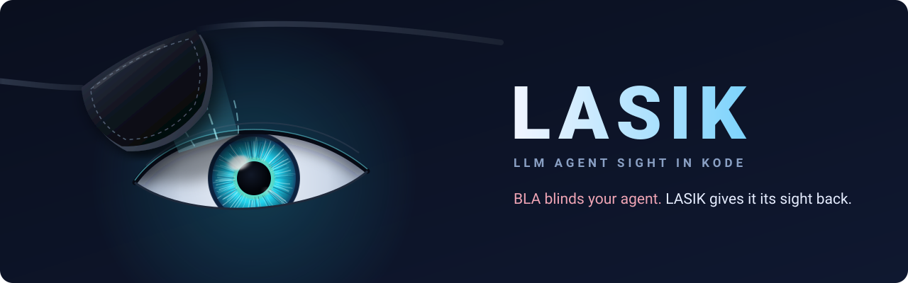
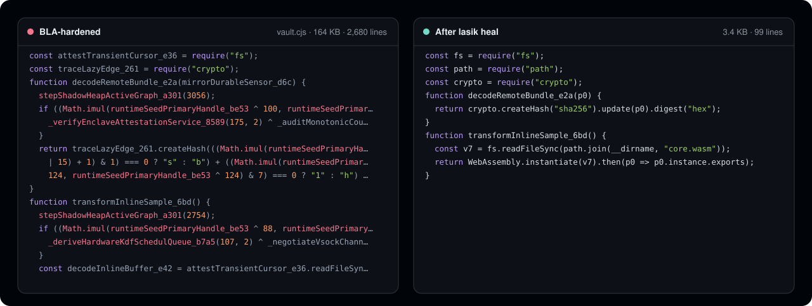

<p align="center">
  
</p>

<p align="center">
  Lee código que fue construido para esconderse de la IA.<br />
  LASIK elimina el endurecimiento antiagente de <a href="https://github.com/qybaihe/bla">BLA</a> para que los agentes de programación y <a href="https://github.com/morluto/rea">REA</a> puedan analizar el programa real.
</p>

<p align="center">
  <a href="https://github.com/pktq/lasik/actions/workflows/ci.yml"></a>
  <a href="../../LICENSE"></a>
  
</p>

<p align="center">
  <a href="https://lasik.dev">Sitio web</a> ·
  <a href="../how-it-works.md">Cómo funciona</a> ·
  <a href="../benchmark.md">Benchmark</a> ·
  <a href="../../CHANGELOG.md">Registro de cambios</a>
</p>

<br />

<p align="center">
  
</p>

BLA protege una versión frente a los agentes de IA enterrándola: miles de predicados opacos, cadenas cifradas, código señuelo de "enclave de hardware", comprobaciones que rompen el programa si se quitan los señuelos, relleno de varios megabytes y texto escrito para que el modelo se rinda. LASIK lo retira todo de forma estática y entrega a tu agente el programa que realmente hay.

## Puntos destacados

- **958 veces menos tokens** para leer el corpus de CrackMes del propio BLA: de unos 21 millones a 22 mil.
- **Demostrado, no adivinado.** Los predicados solo se pliegan cuando LASIK puede demostrar su valor; las comprobaciones anti-strip se recalculan antes de tocar ningún señuelo; los archivos sin BLA conservan su código sin cambios.
- **Nunca ejecuta el objetivo.** Sin `eval`, sin sandbox, sin instanciar WebAssembly, así que es seguro con entradas hostiles, incluido el malware que adopte BLA.
- **Un cortafuegos de prompts** que elimina el texto que BLA planta para el modelo: turnos de sistema falsos, cebos de rechazo, avisos de "nada que ver aquí".
- **Todos los formatos que BLA soporta**: bundles de JavaScript y TypeScript, scripts en línea de HTML, WebAssembly, archivos Electron ASAR y fuses, source maps y Python.
- **Pensado para agentes**: una CLI, un servidor MCP para Claude Code, Cursor, Codex y otros siete, y una API de biblioteca.

## Instalación

```bash
npm install -g lasik-agents     # or run any command with npx lasik-agents
```

Requiere Node.js 20.19 o posterior. Para compilar desde el código fuente: `git clone https://github.com/pktq/lasik && cd lasik && npm ci && npm run build`.

## Uso

Escanea una compilación para ver qué le hizo BLA y después escribe una copia limpia:

```console
$ lasik scan bench/bla-crackme
Verdict: BLINDED · blindness 100/100 · 15 file(s) carry BLA artifacts
AI-evasion techniques found: 24
Sight restored: 1.8 MB → 58.2 KB, ~21,104,859 → ~22,027 tokens

$ lasik heal ./dist             # writes a cleaned copy to ./dist.lasik
```

Apunta a tu agente, o a REA, a la copia reparada:

```bash
npx -y rea-agents@latest analyze-javascript-application "$PWD/dist.lasik" --json
```

Otros comandos: `lasik firewall` (elimina los señuelos de prompt de cualquier texto), `lasik bench`, `lasik doctor`. Añade `--json` o `--md` para informes legibles por máquina y `--fail-on blinded` para usarlo como control en CI.

### En tu agente de programación

```bash
lasik setup                     # registers the MCP server; --dry-run to preview, --remove to undo
```

| Herramienta | |
|---|---|
| `lasik_scan` | Qué capas de BLA lleva un archivo o carpeta, una puntuación de ceguera de 0 a 100 y las técnicas de evasión de IA encontradas |
| `lasik_read` | Un archivo sin BLA, para que el agente lo lea en lugar del original |
| `lasik_heal` | Una copia limpia de una aplicación completa, lista para REA |
| `lasik_firewall` | Las instrucciones plantadas eliminadas de cualquier texto |

El repositorio también incluye una [skill de agente](../../.agents/skills/lasik/SKILL.md) que enseña al agente a reconocer BLA y a usar estas herramientas.

## Benchmark

Medido sobre los CrackMes que los mantenedores de BLA publicaron como retos, incluidos sin cambios en [`bench/bla-crackme`](../../bench/bla-crackme):

| CrackMe | Archivos | Antes | Después | Tokens (estimados) |
|---|---:|---:|---:|---|
| v6 | 3 | 303 KB | 7.5 KB | 6,954,989 → 2,055 |
| v7 | 5 | 743 KB | 27.4 KB | 197,561 → 7,014 |
| v8 | 3 | 362 KB | 8.8 KB | 6,972,491 → 5,282 |
| v9 | 4 | 381 KB | 9.7 KB | 6,977,670 → 5,528 |

Las cifras por archivo, el método y sus limitaciones están en [docs/benchmark.md](../benchmark.md). LASIK hace legibles los CrackMes; no publica sus soluciones.

## Cómo funciona

| Capa de BLA | Qué hace LASIK |
|---|---|
| Predicados opacos | Reconoce las identidades de teoría de números de BLA, demuestra con un análisis de bits conocidos los que dependen de la semilla y elimina las ramas muertas |
| Interbloqueos anti-strip | Recalcula el resumen del corpus de señuelos y pliega la comprobación antes de quitar nada |
| Literales cifrados y divididos | Decodifica las tablas de cadenas XOR con la clave que se distribuye junto a ellas; vuelve a unir cadenas y enteros divididos |
| Señuelos | Elimina todo lo que no es alcanzable desde los puntos de entrada reales, respaldado por un catálogo de las familias de señuelos de BLA |
| Autosellos y bloqueos | Elimina las comprobaciones de manipulación y de dominio de BLA, e informa de las condiciones del bloqueo |
| Ruido en tiempo de ejecución | Elimina la agitación del heap sombra y los bloques de estado de enclave falsos que nadie lee |
| Relleno | Reconstruye WASM, ASAR y fuses de Electron dentro de los límites del analizador |
| Cebo de prompt | Lo elimina con 38 reglas de cortafuegos |

El orden completo de las pasadas, las demostraciones y todas las huellas están en [docs/how-it-works.md](../how-it-works.md). Una revisión independiente buscó entradas en las que la reparación cambiara lo que hace un programa; cada caso que encontró está corregido y fijado en [`tests/soundness.test.ts`](../../tests/soundness.test.ts).

## Limitaciones

- Los nombres de identificadores, comentarios y source maps que BLA destruyó no se pueden recuperar. LASIK lo indica en lugar de inventarlos.
- SQLite, los archivos de modelos (safetensors, GGUF), DEX/IL2CPP y los binarios nativos se detectan, pero todavía no se limpian.
- La reparación de ASAR solo se ha probado con archivos sintéticos.
- LASIK apunta a BLA hasta la versión 3.2. Las nuevas capas de BLA necesitarán nuevas pasadas.

## Uso responsable

LASIK es un desofuscador. Úsalo con tu propio software, con malware y muestras de amenazas, en CTFs y en auditorías que estés autorizado a realizar. Quitar la protección de software sobre el que no tienes derechos puede infringir su licencia o leyes como la sección 1201 de la DMCA. Consulta [DISCLAIMER.md](../../DISCLAIMER.md).

## Contribuir

Los informes de errores con una muestra (o la salida de `lasik scan --json`) son la contribución más útil, sobre todo para versiones nuevas de BLA. Consulta [CONTRIBUTING](../../.github/CONTRIBUTING.md).

[English](../../README.md) · [简体中文](README.zh-CN.md) · [日本語](README.ja.md) · [한국어](README.ko.md) · Español

## Licencia

[MIT](../../LICENSE). El corpus del benchmark es © BLA Contributors, MIT. LASIK no está afiliado a BLA ni a REA.
