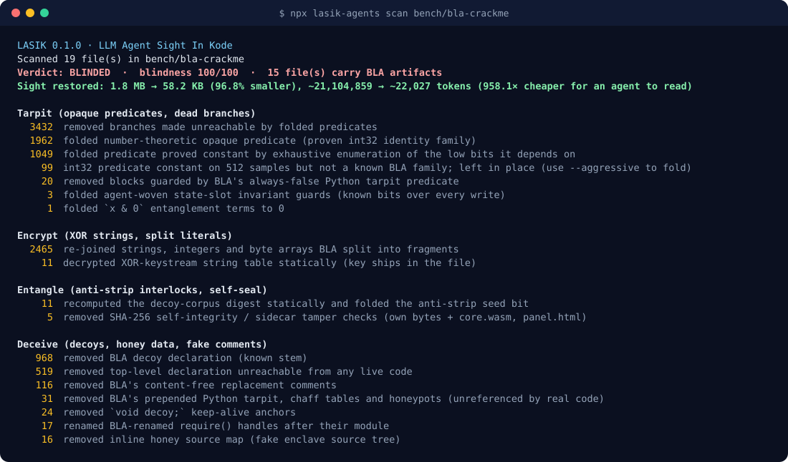

<p align="center"><a href="../../README.md">English</a> | <a href="README.zh-CN.md">简体中文</a> | <a href="README.ja.md">日本語</a> | <a href="README.ko.md">한국어</a> | <a href="README.es.md">Español</a></p>

<div align="center">


# LASIK

### BLA はあなたのエージェントの視界を奪う。LASIK はそれを取り戻す。

**LLM Agent Sight In Kode**: [BLA](https://github.com/qybaihe/bla)（Blind LLM Agents）による堅牢化を取り除き、コーディングエージェントや
[REA](https://github.com/morluto/rea) が本物のプログラムを再び読めるようにする、静的な難読化解除エンジン、CLI、MCP サーバーです。

[](https://www.npmjs.com/package/lasik-agents)
[](https://github.com/pktq/lasik/actions/workflows/ci.yml)
[](../../LICENSE)
[](../../package.json)
[](#-mcpサーバー)
[](#-安全モデル)

</div>

---

**REA** はエージェントにあらゆるものをリバースエンジニアリングする力を与えました。**BLA** はそれに対し、リリースに毒を仕込んでそのエージェントを破産させることで応えました。不透明述語のタールピット、XOR 暗号化された文字列、おとりの「エンクレーブ」コード、アンチストリップのインターロック、自己シール、7 MB の WebAssembly パディング、そしてモデルに拒否させるために書かれたテキストなどです。

**LASIK** は矯正手術です。BLA の述語が定数であることを証明し、隠されたものを復号し、インターロックを切断し、おとりを取り除き、プロンプトの罠を伏せ字にします。**対象を一切実行することなく**。そうすれば、あなたのエージェントはプログラムが実際に何をしているのかを読めます。

<p align="center"></p>

> [!IMPORTANT]
> **防御目的かつ許可された利用に限ります。** LASIK は難読化されたコードを静的に読み取り、実行は一切しません。自分のソフトウェア、マルウェアや脅威サンプル、CTF、監査を許可されたコードに使ってください。[DISCLAIMER.md](../../DISCLAIMER.md) を参照してください。

## 👓 ビフォー / アフター

BLA 自身の CrackMe v6 でのビフォー / アフター:

<p align="center"></p>

そして BLA の CrackMe コーパス全体では次のとおりです:



## ⚡ 30 秒クイックスタート

```bash
# 1. How blind would an agent be?
npx lasik-agents scan ./dist

# 2. Write a cleaned copy next to it (./dist.lasik)
npx lasik-agents heal ./dist

# 3. Point REA (or any coding agent) at the healed copy
npx -y rea-agents@latest analyze-javascript-application "$PWD/dist.lasik" --json
```

お使いのマシン上のすべてのコーディングエージェント（Claude Code、Claude Desktop、Cursor、Codex、Gemini CLI、Windsurf、Antigravity、VS Code、Copilot CLI、OpenCode）に LASIK のツールを提供します:

```bash
npx lasik-agents setup          # --dry-run to preview, --remove to undo
```

Node.js ≥ 20.19 が必要です。ネイティブ依存はなく、ネットワーク通信も行いません。

## 📊 BLA 自身の CrackMe での結果

ベンチマークのコーパスは、BLA が公開している CrackMe の出力 v6〜v9（MIT、[`bench/bla-crackme`](../../bench/bla-crackme) に無変更で同梱）で、BLA 自身のメンテナーが `bankrupt` 強度で堅牢化したものです。`npm run build && node dist/cli.js bench bench/bla-crackme` で再現できます。

<p align="center"></p>

<details>
<summary><b>アーティファクト別の表（サイズ、トークン、倍率）</b></summary>

| アーティファクト | 形式 | 処理前 | 処理後 | トークン数 処理前 → 処理後 | 削減倍率 |
|---|---|---:|---:|---:|---:|
| `v6/core.wasm.gz` | wasm | 17.7 KB (6.9 MB raw) | 0.1 KB | 6,880,354 → 98 | **70,207×** |
| `v6/panel.html` | html | 124.9 KB | 1.9 KB | 32,035 → 476 | 67.3× |
| `v6/vault.cjs` | javascript | 160.7 KB | 5.5 KB | 42,600 → 1,481 | 28.8× |
| `v7/cli/meridian.cjs` | javascript | 169.7 KB | 3.4 KB | 44,897 → 867 | 51.8× |
| `v7/core/expr.cjs` | javascript | 147.2 KB | 8.2 KB | 39,135 → 2,111 | 18.5× |
| `v7/core/license.cjs` | javascript | 169.4 KB | 12.1 KB | 44,823 → 3,091 | 14.5× |
| `v7/core/stats.cjs` | javascript | 125.2 KB | 1.6 KB | 33,515 → 404 | 83.0× |
| `v7/core/units.cjs` | javascript | 131.8 KB | 2.1 KB | 35,191 → 541 | 65.0× |
| `v8/core.wasm.gz` | wasm | 20.9 KB (6.9 MB raw) | 1.8 KB | 6,883,663 → 3,506 | 1,963× |
| `v8/license.cjs` | javascript | 221.2 KB | 5.6 KB | 58,120 → 1,445 | 40.2× |
| `v8/panel.html` | html | 119.7 KB | 1.3 KB | 30,708 → 331 | 92.8× |
| `v9/core.wasm.gz` | wasm | 20.9 KB (6.9 MB raw) | 1.8 KB | 6,883,604 → 3,496 | 1,969× |
| `v9/license.cjs` | javascript | 196.4 KB | 6.2 KB | 52,019 → 1,600 | 32.5× |
| `v9/panel.html` | html | 123.3 KB | 1.2 KB | 31,594 → 299 | 105.7× |
| `v9/policy.py` | python | 40.6 KB | 0.5 KB | 10,453 → 133 | 78.6× |
| **合計** | | **1.75 MB** | **58 KB** | **21.1 M → 22 k** | **958×** |

</details>

コーパス全体で、LASIK は **3,011 個の不透明述語**を畳み込み、**3,432 個のデッドブランチ**を除去し、**2,465 個の分割リテラル**を再結合し、**1,487 個のおとり宣言**と **750 個のおとり WASM エクスポート**を削除し、すべての XOR 文字列テーブルを復号し、**11 個のアンチストリップ・インターロック**と **5 個の自己シール**を切断し、すべてのプロンプトのおとりを伏せ字にします。1 ファイルあたりの処理時間は約 0.3 秒です。

処理後の v6 パネルスクリプトは、公開されているテンプレートの `derive()` ロジックと（BLA によって名前が変えられたローカル変数を除き）1 行ずつ一致します。トークン数は推定値です（コードは 1 トークンあたり約 4 文字、hex/base64 は 2 文字、バイナリは 1 バイトあたり 1 トークン）。

> ネタバレ方針: LASIK はすべての CrackMe を読める状態にしますが、鍵やフラグは公開しません。解くのはあなた自身です。

## 🧠 仕組み

BLA は層を積み重ねます（「Poison → Exhaust → Hallucinate」）。LASIK はそれぞれを静的に元へ戻し、どの程度確実かも示します。

<p align="center"></p>

<details open>
<summary><b>レイヤーごとに: BLA の手口と LASIK の対処</b></summary>

| BLA の層 | BLA がすること | LASIK の対抗策 | 確実性 |
|---|---|---|---|
| **Tarpit** | 約 3k 個の `Math.imul` 不透明述語が、すべての文字列チャンク、整数、文を本物とおとりのどちらにするかを決める | BLA の 4 つの整数論的ファミリー（いずれも int32 上で証明済みの恒等式）に一致させ、さらに**既知ビット証明器**を適用する。ランタイムシードのどのビットが固定かを計算し、述語が依存するビットだけを列挙する | **厳密な証明** |
| **Entangle: interlock** | シードの最下位ビット = `digest(decoyCorpus) === N` なので、おとりを削除するとすべての述語が反転する | ダイジェストを再実装し、手を加えていないコーパスに対して再計算し、何かを削除する*前に*そのビットを畳み込む | 厳密 |
| **Entangle: self-seal / sidecar** | ファイルが自身と兄弟ファイルの SHA-256 を計算し、編集があれば例外を投げる | 形状によって検出して除去する（そのダイジェストは LASIK がすでに無関係と証明したビットにしか使われていない） | BLA の形状に対して厳密 |
| **Entangle: bind-scope** | ドメイン / 日付ロックの IIFE | 除去する。契約内容（ドメイン、有効期間）は報告する | フィンガープリント |
| **Encrypt** | `bla_encrypt_strings` の XOR キーストリームテーブル。文字列と整数は 9 個以上の不透明なチャンクに分割される | 隣に同梱されているキーストリームでテーブルを復号し、述語が畳み込まれたらチャンクを再結合する | 厳密 |
| **Deceive** | 約 140 個の注入ブロック: ハニーポット認証情報、偽の gRPC エンクレーブ、シャドウのビジネスロジック、コールグラフの迷宮、BPE トークンシンク、正規表現マグネット、おとりの診断、ハニーソースマップ、スクランブルされたコメント、`void [decoy]` の延命アンカー | 畳み込み後に実際のエントリポイントから到達可能性によるツリーシェイキングを行い、さらに 25 種のおとりファミリーのフィンガープリントカタログを使う | 厳密（到達可能性） |
| **Runtime** | すべての関数に織り込まれたシャドウヒープのステッパー。デバッガに偽のエンクレーブ状態を返す「Truman show」ブロック | プライベート状態のシンク解析: 他のどこからも読まれない状態だけを変更する関数は観測不能なので、その呼び出しを除去する | 閉じた状態に対して厳密 |
| **Weave** | エージェントが書いた状態スロットが、`(slot.epoch & 1) !== 0` や `x & 0` の混合で本物のコードを守る | スロットへのすべての書き込みにわたる既知ビット、代数的ゼロ | 厳密。自由形式の weave はラベル付けし、推測はしない |
| **Exhaust** | 6.9 MB の WASM 名前/セクションパディング、250 個のおとりエクスポート、16 MiB の ASAR ヘッダー、34 個の fuse センチネル | REA の予算内で WASM（検証済み）、ASAR（オフセットを書き換え）、fuse の連なりを再構築する | 厳密 |
| **Prompt** | 偽の `system`/チャットターン、拒否の罠、「ビジネスロジックは存在しない」という主張、偽の COPPA/IEC 62304 通知、カナリア GUID | **プロンプトファイアウォール**: 40 個のルールが、モデルが読む前にテキストを伏せ字にする（`heal` では動作を保ち、`lasik_read` では完全に伏せ字にする） | フィンガープリント + フレーズルール |

</details>

パスの完全な順序とすべてのフィンガープリントは [`docs/how-it-works.md`](../how-it-works.md) に記載されています。

### 信頼できる理由

- **推測ではなく証明。** デフォルトモードは、証明できるものだけを畳み込みます。ヒューリスティックな畳み込み（`--aggressive`）はオプトインで、別枠で報告され、パラメータや入力には決して触れません。テストスイートがこれを固定しています。本物の `(key ^ K) === C` ライセンスチェックが畳み込まれることはありません。
- **クリーンなコードには触れない。** BLA の証拠がないファイルはバイト単位で同一のまま戻ります。プロンプトファイアウォールが伏せ字にできるのはそのコメントだけです。
- **修復しても動作は変わらない。** `heal` の出力では、ファイアウォールはコメントと BLA 固有の文字列だけを伏せ字にします。プロンプトの形をした*実行時*文字列（たとえば実際のチャットアプリにある ChatML マーカー）は、書き換えられずに報告されます。`lasik_read` と `--strict-firewall` は、エージェントに完全に伏せ字にした閲覧用ビューを提供します。
- **独立してレビュー済み。** 別途行われた敵対的レビューが、あるパスで動作が変わってしまう入力を探し、15 件を発見しました。すべて修正され、[`tests/soundness.test.ts`](../../tests/soundness.test.ts) に固定されています（テストは全部で 85 件）。
- **順序が重要であり、強制される。** どのおとりを削除するよりも前にインターロックを切断するので、処理後のプログラムは BLA の本物のコードが期待するシードを保ちます。

## フォーマット対応

<!-- coverage:start -->
Pinned to BLA **3.2.1**. 58/63 BLA shield files fully healed; 44 more emit nothing into artifacts. Full per-file table: [docs/coverage.md](../coverage.md).

| Surface | Status |
|---|---|
| .NET assembly | ✅ healed |
| Android APK | ✅ healed |
| Android DEX | ✅ healed |
| Apple plist | ✅ healed |
| Bind-scope licence lock | 🔎 detect-only |
| Bun standalone | ✅ healed |
| Electron ASAR | ✅ healed |
| Erlang BEAM | ✅ healed |
| EVM bytecode | ✅ healed |
| Firmware UF2 | ✅ healed |
| GPU PTX | ✅ healed |
| JavaScript / HTML | 🟡 partial |
| JVM class | ✅ healed |
| Mobile game (DEX / IL2CPP) | ✅ healed |
| Native ELF / PE / Mach-O | 🟡 partial |
| PCAP | ✅ healed |
| Prompt text | ✅ healed |
| Python | ✅ healed |
| Safetensors / GGUF | ✅ healed |
| Sidecar entanglement | ✅ healed |
| Source maps | ✅ healed |
| SQLite | ✅ healed |
| WebAssembly | ✅ healed |
| ZIP / JAR / APK | ✅ healed |
<!-- coverage:end -->

## 🛡️ 安全モデル

- **LASIK は読み込むコードを決して実行しません。** `eval` も `vm` も、対象の `require` も、WebAssembly のインスタンス化もありません（モジュールはパースされ、`WebAssembly.validate` に渡されるだけです）。定数評価は、閉じた整数サブセットに対する LASIK 自身の AST インタプリタ上で行われます。
- そのため、AI アナリストの目をくらますために BLA を採用するマルウェアを含め、敵対的な入力に対しても使えます。
- ネットワークアクセスもテレメトリもありません。

## 🔌 MCPサーバー

`npx lasik-agents setup` は、`npx -y lasik-agents mcp` をお使いのエージェントに登録します。ツール:

| ツール | 機能 |
|---|---|
| `lasik_scan` | ファイルまたはディレクトリ内の BLA の層を検出し、盲目度スコア 0〜100 とトークン削減量を返す |
| `lasik_read` | BLA を取り除いた JS/TS/HTML ファイルを 1 つ返す: エージェントが元のファイルの代わりに読むべきもの |
| `lasik_heal` | アプリ全体（JS、HTML、ASAR、`.wasm.gz` を含む WASM、ソースマップ、fuse）のクリーンなコピーを REA 向けに書き出す |
| `lasik_firewall` | あらゆるテキストについて、推論に使う前にプロンプトのおとりを伏せ字にする |

サーバーは、BLA の見分け方（エンクレーブ/TEE の話、`Math.imul` 述語、XOR テーブル、拒否テキスト）もエージェントに伝えるので、エージェントは自ら LASIK を使うようになります。スキルを読み込むエージェント向けには[エージェントスキル](../../.agents/skills/lasik/SKILL.md)があります。

## 🖥️ CLI

```text
lasik scan <path>            Detect BLA hardening and score how blinded an agent would be
lasik heal <path> [-o dir]   Write a cleaned copy (default: <path>.lasik)
lasik firewall [file|-]      Redact LLM-directed decoy text from any text
lasik bench <dir>            Before/after table for every artifact under <dir>
lasik setup | doctor | mcp

--json | --md                Report formats       --aggressive     Opt-in heuristics
--no-firewall --no-rename    Keep text / names    --fail-on <lvl>  CI gate (exit 3)
--strict-firewall            Redact prompt decoys in runtime strings too (read view)
```

CI の例: ベンダリングしている依存関係が BLA で盲目化されたコードを含んでいたら、パイプラインを失敗させます:

```bash
npx lasik-agents scan vendor/ --fail-on blinded
```

## 📦 ライブラリ

```ts
import { run, healJs, firewallText } from "lasik-agents";

const report = run("./dist", "heal", { outDir: "./dist.lasik" });
console.log(report.verdict, report.blindness, report.totals);

const { code, findings } = healJs(source, { filename: "bundle.js" });
const { text } = firewallText(untrustedString);
```

## 🔬 正直な限界

- **名前とコメントは失われています。** `bankrupt`/`maximum` では、BLA は元の識別子のヒントを一切残しません。LASIK は `require` ハンドルをそのモジュールにちなんで名前変更し、ハッシュ化されたパネル ABI を復元しますが、それ以上のことはしません。元のコメントとソースマップは復元できません。LASIK はそれらをでっち上げず、そのことを正直に伝えます。
- **Python** の修復はテキスト構造的です（BLA の Python エミッターは規則的です）。タールピットのガード、スロットの churn、先頭に付加されたプレリュードは除去され、LASIK が解析できないものは警告付きでそのまま残されます。
- **SQLite、safetensors/GGUF、DEX/IL2CPP、ネイティブバイナリ**: 現時点では検出のみです。ASAR の修復は合成アーカイブでテストされており、公開されている BLA の ASAR サンプルはまだありません。
- BLA が `ops_<hex>_…` に名前変更した **WASM エクスポート名**は、名前変更されたままになります（報告されます）。
- **軍拡競争。** LASIK は BLA ≤ 3.2 を対象としています。新しい BLA の層には新しいパスが必要になります。証明（既知ビット、到達可能性）は、フィンガープリントよりもうまく引き継がれます。
- **ランタイムの等価性**は、対象を実行することではなく、静的に（厳密な証明と、BLA が公開している CrackMe テンプレートとの構造比較によって）確立されます。

## ⚖️ 責任ある利用

LASIK は難読化解除ツールです。ご自身が所有するソフトウェア、マルウェアや脅威のサンプル、CTF やチャレンジ（BLA の CrackMe のようなもの）、監査する権限のあるコードに対して使用してください。他者のソフトウェアから保護を取り除くことは、そのライセンスや米国 DMCA §1201 などの法律に違反する可能性があります。[DISCLAIMER.md](../../DISCLAIMER.md) を参照してください。

## ❓ FAQ

<details>
<summary><b>これは反 BLA ですか?</b></summary>

はい。第三幕です: REA がリバースエンジニアリングし、BLA が視界を奪い、LASIK が視力を取り戻します。

</details>

<details>
<summary><b>なぜ防御側がこれを必要とするのですか?</b></summary>

攻撃者も BLA を使うからです。BLA で包まれたマルウェアは、あなたの AI アナリストを拒否させたり、停滞させたり、予算を使い果たさせたりするように作られています。LASIK はあなたのアナリストが作業を続けられるようにし、そのプロンプトファイアウォールはコードに仕込まれた命令に対する汎用的な防御にもなります。さらに、すべてのスキャンは **「AI-evasion techniques found: N」** を報告します。AI による解析から隠れようとするコードは、それ自体がリスクのシグナルです。

</details>

<details>
<summary><b>REA は必要ですか?</b></summary>

いいえ。どのコーディングエージェントでも LASIK の出力を読めますし、`lasik_read` を直接呼び出すこともできます。LASIK はコンパイル済みの対象に対して REA と自然に組み合わせられます。

</details>

<details>
<summary><b>BLA はすぐに回避策を打ってくるのでは?</b></summary>

おそらくそうでしょう。フィンガープリントは BLA にとって変更が容易ですが、厳密な証明はそうではありません。BLA が保護するプログラムは、それでも同じように動作しなければならないからです。この非対称性こそが、LASIK の拠り所です。

</details>

## 🤝 コントリビューション

新しい BLA バージョンでパスが壊れましたか? アーティファクト（または最小の再現例）と `lasik scan --json` の出力を添えて issue を立ててください。[CONTRIBUTING.md](../../CONTRIBUTING.md) を参照してください。PR を送る前に `npm test` を実行してください。

## 📄 ライセンス

MIT © LASIK contributors。`bench/bla-crackme` のベンチマークコーパスは © BLA Contributors、MIT で、無変更で同梱されています（[LICENSE-BLA](../../bench/bla-crackme/LICENSE-BLA)）。LASIK は BLA および REA とは提携していません。
