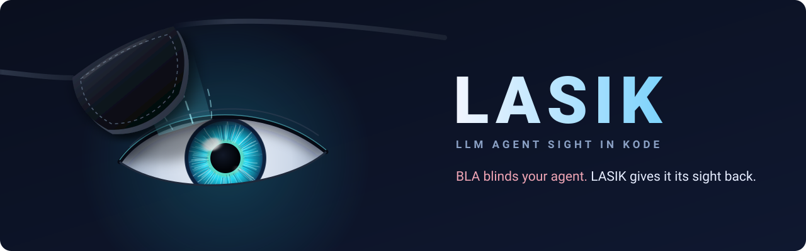
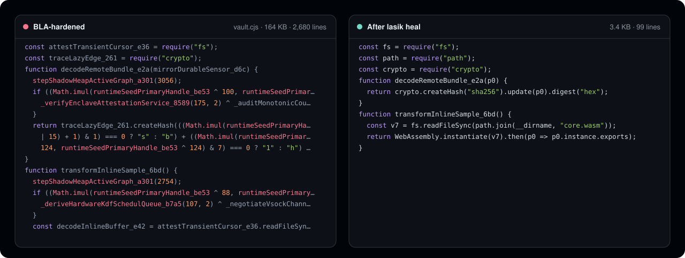
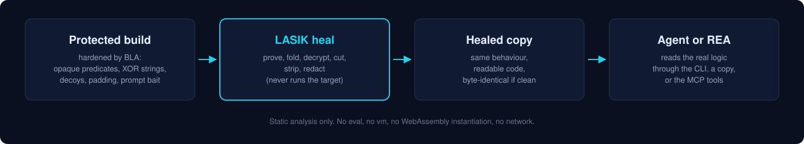
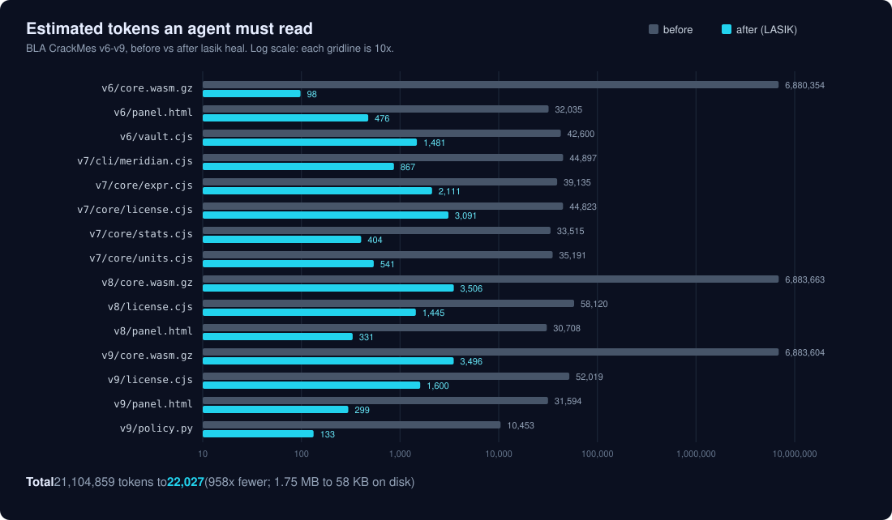
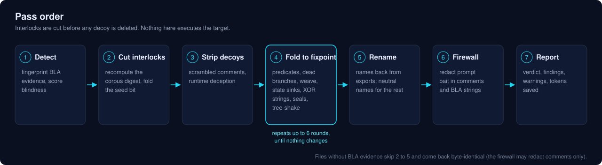

<p align="center"><a href="../../README.md">English</a> · <a href="README.zh-CN.md">简体中文</a> · <b>日本語</b> · <a href="README.ko.md">한국어</a> · <a href="README.es.md">Español</a></p>

<p align="center">
  
</p>

<p align="center">
  AI から隠れるように作られたコードを読む。<br />
  LASIK は <a href="https://github.com/qybaihe/bla">BLA</a> のエージェント対策の硬化処理を取り除き、コーディングエージェントと <a href="https://github.com/morluto/rea">REA</a> が本物のプログラムを解析できるようにします。
</p>

<p align="center">
  <a href="https://www.npmjs.com/package/lasik-agents"></a>
  <a href="https://www.npmjs.com/package/lasik-agents"></a>
  <a href="https://github.com/pktq/lasik/actions/workflows/ci.yml"></a>
  <a href="https://github.com/pktq/lasik/actions/workflows/bla-drift.yml"></a>
  <a href="https://github.com/pktq/lasik/stargazers"></a>
  <br />
  <a href="../../docs/coverage.md"></a>
  <a href="../../tests/fixtures/bla-3.2.1"></a>
  <a href="../../docs/coverage.md"></a>
  <a href="../../docs/how-it-works.md"></a>
  <a href="../../LICENSE"></a>
  <a href="https://nodejs.org"></a>
</p>

<p align="center">
  <a href="../how-it-works.md">仕組み</a> ·
  <a href="../benchmark.md">ベンチマーク</a> ·
  <a href="../../CHANGELOG.md">変更履歴</a>
</p>

<br />

<p align="center">
  
</p>

BLA は、リリースを埋め尽くすことで AI エージェントから守ります。数千の不透明述語、暗号化された文字列、偽の「ハードウェアエンクレーブ」コード、おとりを取り除くとプログラムが壊れる検査、数 MB のパディング、そしてモデルに諦めさせるために書かれたテキストです。LASIK はそのすべてを静的に取り除き、実際にあるプログラムをエージェントに渡します。

<p align="center"></p>

## 特長

- **トークン数を 1,262 分の 1 に。** BLA 自身の CrackMe コーパスを読むとき、約 2,100 万から 1.7 万に減ります。
- **推測ではなく証明。** 述語は LASIK が値を証明できたときだけ畳み込みます。anti-strip 検査は、おとりに触れる前に再計算します。BLA を含まないファイルのコードは変わりません。
- **対象を実行しません。** `eval` も、サンドボックスも、WebAssembly のインスタンス化も使わないため、BLA を採用したマルウェアを含む悪意ある入力に対しても安全です。
- **プロンプトファイアウォール。** BLA がモデル向けに仕込むテキスト、つまり偽のシステムターン、拒否を誘う餌、「ここには何もありません」という通知を取り除きます。
- **BLA が扱うすべての形式に対応し、実際の BLA 3.2.1 の出力で確認済み。** JavaScript/TypeScript, HTML, WebAssembly, Electron ASAR/fuses, source maps, Python/`.pyc`, ELF/PE/Mach-O, Bun, SQLite, safetensors/GGUF, PCAP, JVM, .NET, BEAM, EVM, PTX, ZIP/APK/DEX, plist, IL2CPP, UF2。
- **プログラムが公開している名前を復元。** BLA が `primeSparseStack_719` に改名しても `clampPan` としてエクスポートされている関数は `clampPan` に戻ります。それ以外の BLA の名前は、誤解を招く名前ではなく中立的な名前（`p0`、`v0`）になります。
- **BLA の更新に追従。** BLA のすべてのソースファイルのハッシュを [coverage/bla.json](../../coverage/bla.json) に記録し、BLA が変わるとすぐに週次ジョブが issue を作成します。
- **エージェント向けに作られています。** CLI、Claude Code、Cursor、Codex ほか 7 つに対応する MCP サーバー、そしてライブラリ API を備えます。

## インストール

```bash
npm install -g lasik-agents     # or run any command with npx lasik-agents
```

Node.js 20.19 以降が必要です。ソースからビルドするには: `git clone https://github.com/pktq/lasik && cd lasik && npm ci && npm run build`

## 使い方

ビルドをスキャンして BLA が何をしたかを確認し、クリーンなコピーを書き出します。

```console
$ lasik scan bench/bla-crackme
Verdict: BLINDED · blindness 100/100 · 15 file(s) carry BLA artifacts
AI-evasion techniques found: 24
Sight restored: 1.8 MB → 37.5 KB, ~21,104,859 → ~16,718 tokens

$ lasik heal ./dist             # writes a cleaned copy to ./dist.lasik
```

エージェントまたは REA に、修復したコピーを渡します。

```bash
npx -y rea-agents@latest analyze-javascript-application "$PWD/dist.lasik" --json
```

そのほかのコマンド: `lasik firewall`（任意のテキストからプロンプトのおとりを除去）、`lasik bench`、`lasik doctor`。`--json` または `--md` を付けると機械可読なレポートが得られ、`--fail-on blinded` を付けると CI のゲートにできます。

### コーディングエージェントで使う

```bash
lasik setup                     # registers the MCP server; --dry-run to preview, --remove to undo
```

| ツール | |
|---|---|
| `lasik_scan` | ファイルまたはフォルダにどの BLA レイヤーがあるか、0〜100 の盲目度スコア、見つかった AI 回避手法 |
| `lasik_read` | BLA を取り除いた 1 ファイル。エージェントが元のファイルの代わりに読むためのもの |
| `lasik_heal` | アプリ全体のクリーンなコピー。そのまま REA に渡せます |
| `lasik_firewall` | 任意のテキストから、仕込まれた指示を除去したもの |

このリポジトリには [エージェントスキル](../../.agents/skills/lasik/SKILL.md) も含まれており、エージェントに BLA を見分けてこれらのツールを使うことを教えます。

## ベンチマーク

BLA のメンテナーが課題として公開した CrackMe で計測しました。[`bench/bla-crackme`](../../bench/bla-crackme) に無改変で同梱しています。

| CrackMe | ファイル数 | 処理前 | 処理後 | トークン（推定） |
|---|---:|---:|---:|---|
| v6 | 3 | 303 KB | 4.9 KB | 6,954,989 → 1,398 |
| v7 | 5 | 743 KB | 13.6 KB | 197,561 → 3,483 |
| v8 | 3 | 362 KB | 6.7 KB | 6,972,491 → 4,748 |
| v9 | 4 | 381 KB | 7.4 KB | 6,977,670 → 4,941 |

<p align="center"></p>

<!-- realbench:start -->
On a project we hardened ourselves with the published `bla-agents@3.2.1`, one file per format ([details](../benchmark.md#your-own-code-hardened-by-real-bla-321)):

| BLA run | Files | Original | BLA-hardened | After LASIK | Tokens (estimated) | Result |
|---|---:|---:|---:|---:|---|---|
| Defaults | 21 | 151.9 KB | 31.1 MB | 150.9 KB | 32,154,076 → 152,102 | 21/21 healed, 11 byte-identical |
| All opt-in layers | 21 | 151.9 KB | 31.2 MB | 151.0 KB | 32,178,121 → 152,197 | 21/21 healed, 10 byte-identical |
<!-- realbench:end -->

ファイルごとの数値、測定方法とその注意点は [docs/benchmark.md](../benchmark.md) にあります。LASIK は CrackMe を読める状態にしますが、解答は公開しません。

## 仕組み

<p align="center"></p>

| BLA のレイヤー | LASIK の処理 |
|---|---|
| 不透明述語 | BLA の整数論的恒等式に一致させ、シードに依存するものは既知ビット解析で証明したうえで、到達しない分岐を取り除く |
| anti-strip インターロック | おとりコーパスのダイジェストを再計算して検査を畳み込んでから、何かを取り除く |
| 暗号化・分割されたリテラル | 隣に同梱されたキーで XOR 文字列テーブルを復号し、分割された文字列と整数を結合し直す |
| おとり | 実際のエントリポイントから到達できないものをすべて除去する。根拠は BLA のおとりファミリーのカタログ |
| セルフシールとロック | BLA 自身の改ざん検査とドメイン検査を取り除き、ロックの条件を報告する |
| 実行時ノイズ | 誰も読まないシャドウヒープの揺れと偽のエンクレーブ状態ブロックを除去する |
| 改名された識別子 | プログラムがエクスポートまたはインポートしている名前を復元し、それ以外は中立的な名前にする |
| パディングと埋め込みデータ | バイナリ、データベース、モデル、アーカイブから BLA のセクション、トレーラー、ハニーテーブル、おとりエントリ、大量データを取り除き、ファイルが有効なままになるようオフセットとチェックサムを再構築する |
| プロンプトの餌 | 40 のファイアウォールルールで除去する |

処理の完全な順序、証明、すべてのフィンガープリントは [docs/how-it-works.md](../how-it-works.md) にあります。独立したレビューで、修復によってプログラムの動作が変わる入力を探しました。見つかったケースはすべて修正済みで、[`tests/soundness.test.ts`](../../tests/soundness.test.ts) に固定されています。

## 形式ごとの対応状況

<!-- coverage:start -->
Pinned to BLA **3.2.1**. 59/63 BLA shield files fully healed; 44 more emit nothing into artifacts. Full per-file table: [docs/coverage.md](../coverage.md).

| Surface | Status |
|---|---|
| .NET assembly | ✅ healed |
| Android APK | ✅ healed |
| Android DEX | ✅ healed |
| Apple plist | ✅ healed |
| Bun standalone | ✅ healed |
| Electron ASAR | ✅ healed |
| Erlang BEAM | ✅ healed |
| EVM bytecode | ✅ healed |
| Firmware UF2 | ✅ healed |
| GPU PTX | ✅ healed |
| JavaScript / HTML | 🟡 partial |
| JVM class | ✅ healed |
| Mobile game (DEX / IL2CPP) | ✅ healed |
| Native ELF / PE / Mach-O | 🟡 partial |
| PCAP | ✅ healed |
| Prompt text | ✅ healed |
| Python | ✅ healed |
| Safetensors / GGUF | ✅ healed |
| Sidecar entanglement | ✅ healed |
| Source maps | ✅ healed |
| SQLite | ✅ healed |
| WebAssembly | ✅ healed |
| ZIP / JAR / APK | ✅ healed |
<!-- coverage:end -->

## 制限事項

- ローカル名、コメント、ソースマップ、そして BLA が上書きした一部のセクション（Go の `.go.buildinfo`、改名された WASM のエクスポート）は復元できません。LASIK は作り上げるのではなく、その旨を伝えます。
- 形式ごとの修復は BLA 3.2.1 の出力を正確に認識します。21 形式について実際の BLA の出力で確認済みです（[tests/fixtures/bla-3.2.1](../../tests/fixtures/bla-3.2.1)）。Go、Flutter、Bun、BEAM、APK/DEX、IL2CPP は、今のところ BLA のソースから作ったフィクスチャでのみ確認しています。
- BLA が変わると、修復が更新されるまで一致しなくなることがあります。週次の差分チェックが見直すべきファイルを示します。JavaScript のコアは証明に基づいて動作し、BLA の名前には依存しません。

## 責任ある利用

LASIK は難読化解除ツールです。ご自身のソフトウェア、マルウェアや脅威サンプル、CTF、そして実施を許可された監査にご利用ください。権利のないソフトウェアから保護を取り除くと、ライセンスや DMCA §1201 などの法律に違反するおそれがあります。[DISCLAIMER.md](../../DISCLAIMER.md) を参照してください。

## コントリビュート

サンプル（または `lasik scan --json` の出力）を添えたバグ報告が最も役に立ちます。特に新しいバージョンの BLA についての報告を歓迎します。[CONTRIBUTING](../../.github/CONTRIBUTING.md) を参照してください。

[English](../../README.md) · [简体中文](README.zh-CN.md) · 日本語 · [한국어](README.ko.md) · [Español](README.es.md)

## ライセンス

[MIT](../../LICENSE)。ベンチマークのコーパスの著作権は BLA Contributors に帰属し、MIT ライセンスです。LASIK は BLA および REA とは無関係です。
