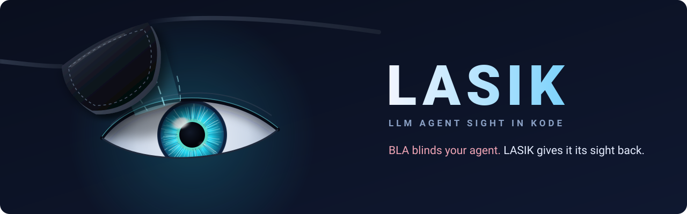
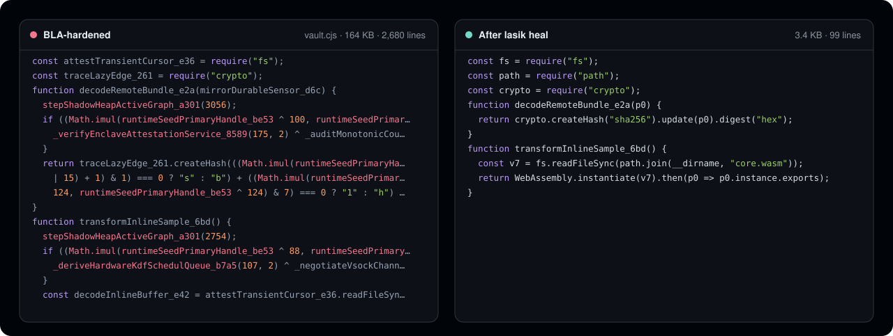

<p align="center">
  
</p>

<p align="center">
  AI를 피하도록 만들어진 코드를 읽습니다.<br />
  LASIK은 <a href="https://github.com/qybaihe/bla">BLA</a>의 에이전트 방지 경화를 제거해, 코딩 에이전트와 <a href="https://github.com/morluto/rea">REA</a>가 실제 프로그램을 분석할 수 있게 합니다.
</p>

<p align="center">
  <a href="https://github.com/pktq/lasik/actions/workflows/ci.yml"></a>
  <a href="../../LICENSE"></a>
  
</p>

<p align="center">
  <a href="https://lasik.dev">웹사이트</a> ·
  <a href="../how-it-works.md">동작 방식</a> ·
  <a href="../benchmark.md">벤치마크</a> ·
  <a href="../../CHANGELOG.md">변경 내역</a>
</p>

<br />

<p align="center">
  
</p>

BLA는 릴리스를 파묻어서 AI 에이전트로부터 보호합니다. 수천 개의 불투명 술어, 암호화된 문자열, 가짜 "하드웨어 인클레이브" 코드, 미끼를 제거하면 프로그램이 깨지도록 하는 검사, 수 MB의 패딩, 그리고 모델이 포기하도록 쓰인 텍스트가 그 수단입니다. LASIK은 이 모든 것을 정적으로 되돌려 제거하고, 실제로 존재하는 프로그램을 에이전트에게 넘겨줍니다.

## 주요 특징

- **토큰 958배 감소.** BLA 자체 CrackMe 코퍼스를 읽을 때 약 2,100만에서 2만 2천으로 줄어듭니다.
- **추측이 아닌 증명.** 술어는 LASIK이 값을 증명할 수 있을 때만 접습니다. 미끼를 건드리기 전에 anti-strip 검사를 먼저 다시 계산합니다. BLA가 없는 파일의 코드는 바뀌지 않습니다.
- **대상을 실행하지 않습니다.** `eval`도, 샌드박스도, WebAssembly 인스턴스화도 없으므로 BLA를 도입한 악성코드를 포함해 악의적인 입력에도 안전합니다.
- **프롬프트 방화벽.** BLA가 모델을 겨냥해 심어 둔 텍스트, 즉 가짜 시스템 턴, 거부 유도 미끼, "볼 것 없음" 안내문을 제거합니다.
- **BLA가 다루는 모든 형식 지원.** JavaScript 및 TypeScript 번들, 인라인 HTML 스크립트, WebAssembly, Electron ASAR 아카이브와 fuse, 소스 맵, Python.
- **에이전트를 위해 만들었습니다.** CLI, Claude Code, Cursor, Codex 등 7개를 더 지원하는 MCP 서버, 그리고 라이브러리 API를 제공합니다.

## 설치

```bash
npm install -g lasik-agents     # or run any command with npx lasik-agents
```

Node.js 20.19 이상이 필요합니다. 소스에서 빌드하려면: `git clone https://github.com/pktq/lasik && cd lasik && npm ci && npm run build`

## 사용법

빌드를 스캔해 BLA가 무엇을 했는지 확인한 다음, 정리된 사본을 만듭니다.

```console
$ lasik scan bench/bla-crackme
Verdict: BLINDED · blindness 100/100 · 15 file(s) carry BLA artifacts
AI-evasion techniques found: 24
Sight restored: 1.8 MB → 58.2 KB, ~21,104,859 → ~22,027 tokens

$ lasik heal ./dist             # writes a cleaned copy to ./dist.lasik
```

에이전트나 REA에게 복구된 사본을 가리켜 주세요.

```bash
npx -y rea-agents@latest analyze-javascript-application "$PWD/dist.lasik" --json
```

다른 명령: `lasik firewall`(임의의 텍스트에서 프롬프트 미끼를 제거), `lasik bench`, `lasik doctor`. `--json` 또는 `--md`를 붙이면 기계가 읽을 수 있는 보고서를 얻고, `--fail-on blinded`를 붙이면 CI 게이트로 쓸 수 있습니다.

### 코딩 에이전트에서

```bash
lasik setup                     # registers the MCP server; --dry-run to preview, --remove to undo
```

| 도구 | |
|---|---|
| `lasik_scan` | 파일이나 폴더에 어떤 BLA 계층이 있는지, 0–100 실명 점수, 발견된 AI 회피 기법 |
| `lasik_read` | BLA를 제거한 파일 하나. 에이전트가 원본 대신 읽도록 하는 용도 |
| `lasik_heal` | 앱 전체의 정리된 사본. 바로 REA에 넘길 수 있습니다 |
| `lasik_firewall` | 임의의 텍스트에서 심어진 지시문을 제거한 결과 |

이 저장소에는 에이전트가 BLA를 알아보고 이 도구들을 사용하도록 가르치는 [에이전트 스킬](../../.agents/skills/lasik/SKILL.md)도 들어 있습니다.

## 벤치마크

BLA 메인테이너가 과제로 공개한 CrackMe로 측정했으며, [`bench/bla-crackme`](../../bench/bla-crackme)에 수정 없이 포함되어 있습니다.

| CrackMe | 파일 수 | 이전 | 이후 | 토큰(추정) |
|---|---:|---:|---:|---|
| v6 | 3 | 303 KB | 7.5 KB | 6,954,989 → 2,055 |
| v7 | 5 | 743 KB | 27.4 KB | 197,561 → 7,014 |
| v8 | 3 | 362 KB | 8.8 KB | 6,972,491 → 5,282 |
| v9 | 4 | 381 KB | 9.7 KB | 6,977,670 → 5,528 |

파일별 수치, 측정 방법과 그 한계는 [docs/benchmark.md](../benchmark.md)에 있습니다. LASIK은 CrackMe를 읽을 수 있게 만들 뿐, 풀이를 공개하지는 않습니다.

## 동작 방식

| BLA 계층 | LASIK의 처리 |
|---|---|
| 불투명 술어 | BLA의 정수론 항등식을 매칭하고, 시드에 의존하는 것은 알려진 비트 분석으로 증명한 뒤 죽은 분기를 제거 |
| anti-strip 인터락 | 미끼 코퍼스의 다이제스트를 다시 계산해 검사를 접은 다음에 무엇이든 제거 |
| 암호화·분할된 리터럴 | 함께 배포된 키로 XOR 문자열 테이블을 복호화하고, 분할된 문자열과 정수를 다시 결합 |
| 미끼 | 실제 진입점에서 도달할 수 없는 모든 것을 제거. 근거는 BLA 미끼 계열 카탈로그 |
| 셀프 실과 락 | BLA 자체의 변조 검사와 도메인 검사를 제거하고 락의 조건을 보고 |
| 런타임 노이즈 | 아무도 읽지 않는 섀도 힙 변동과 가짜 인클레이브 상태 블록을 제거 |
| 패딩 | 분석기 한도 안에서 WASM, ASAR, Electron fuse를 다시 구성 |
| 프롬프트 미끼 | 38개의 방화벽 규칙으로 제거 |

전체 처리 순서, 증명, 모든 핑거프린트는 [docs/how-it-works.md](../how-it-works.md)에 있습니다. 독립 검토에서 복구가 프로그램의 동작을 바꾸는 입력을 찾아 보았고, 발견된 모든 사례는 수정되어 [`tests/soundness.test.ts`](../../tests/soundness.test.ts)에 고정되어 있습니다.

## 한계

- BLA가 파괴한 식별자 이름, 주석, 소스 맵은 복구할 수 없습니다. LASIK은 지어내는 대신 그 사실을 알려 줍니다.
- SQLite, 모델 파일(safetensors, GGUF), DEX/IL2CPP, 네이티브 바이너리는 탐지만 하며 아직 정리하지 못합니다.
- ASAR 복구는 합성 아카이브로만 테스트했습니다.
- LASIK은 BLA 3.2까지를 대상으로 합니다. 새로운 BLA 계층에는 새로운 패스가 필요합니다.

## 책임 있는 사용

LASIK은 난독화 해제 도구입니다. 본인의 소프트웨어, 악성코드와 위협 샘플, CTF, 그리고 수행할 권한이 있는 감사에 사용하세요. 권리가 없는 소프트웨어에서 보호를 제거하면 라이선스나 DMCA §1201 같은 법률을 위반할 수 있습니다. [DISCLAIMER.md](../../DISCLAIMER.md)를 참고하세요.

## 기여하기

샘플(또는 `lasik scan --json` 출력)을 첨부한 버그 리포트가 가장 도움이 되는 기여이며, 특히 새로운 BLA 버전에 대한 리포트를 환영합니다. [CONTRIBUTING](../../.github/CONTRIBUTING.md)을 참고하세요.

[English](../../README.md) · [简体中文](README.zh-CN.md) · [日本語](README.ja.md) · 한국어 · [Español](README.es.md)

## 라이선스

[MIT](../../LICENSE). 벤치마크 코퍼스의 저작권은 BLA Contributors에게 있으며 MIT 라이선스입니다. LASIK은 BLA 및 REA와 제휴 관계가 없습니다.
