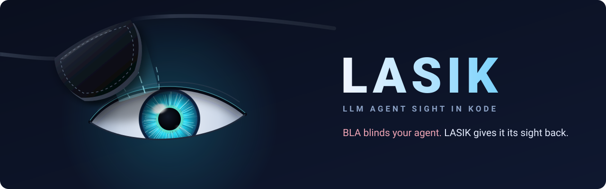

<p align="center"><a href="../../README.md">English</a> | <a href="README.zh-CN.md">简体中文</a> | <a href="README.ja.md">日本語</a> | <a href="README.ko.md">한국어</a> | <a href="README.es.md">Español</a></p>

<div align="center">



# LASIK

### BLA 让你的智能体失明，LASIK 帮它重见光明。

**LLM Agent Sight In Kode**：一个静态去盲引擎，同时提供 CLI 和 MCP 服务器，用于剥除
[BLA](https://github.com/qybaihe/bla)（Blind LLM Agents）的加固，让编码智能体和
[REA](https://github.com/morluto/rea) 重新读懂真实的程序。

[](https://www.npmjs.com/package/lasik-agents)
[](https://github.com/pktq/lasik/actions/workflows/ci.yml)
[](../../LICENSE)
[](../../package.json)
[](#-mcp-服务器)
[](#-安全模型)

</div>

---

**REA** 教会了智能体逆向一切。**BLA** 的回应是向发布物投毒，直到这些智能体耗尽预算：不透明谓词陷阱、XOR 加密的字符串、伪造的“飞地”代码、反剥离联锁、自封印、7 MB 的 WebAssembly 填充，以及专门写来让模型拒绝工作的文本。

**LASIK** 就是矫正手术。它证明 BLA 的谓词为常量，解密被隐藏的内容，切断它的联锁，丢弃它的诱饵，并涂抹它的提示词诱饵，**全程无需运行目标程序**。之后，你的智能体读到的就是程序真正在做的事。

```text
                    ┌────────────┐      ┌────────────┐      ┌────────────┐
   your release ──▶ │    BLA     │ ──▶  │   LASIK    │ ──▶  │ REA / agent│ ──▶ the real logic
                    │ poison +   │      │ prove, fold│      │ reads 958× │
                    │ exhaust    │      │ decrypt,   │      │ fewer      │
                    └────────────┘      │ strip      │      │ tokens     │
                                        └────────────┘      └────────────┘
```

## 👓 前后对比

智能体在 BLA 自带的 CrackMe v6 中看到的内容（该文件中约 3,000 个不透明谓词之一）：

```js
// BLA-hardened (vault.cjs, 164 KB, 2,680 lines)
attestTransientCursor_e36 = require("fs"); …
traceLazyEdge_261.createHash(((Math.imul(runtimeSeedPrimaryHandle_be53 | 15, (runtimeSeedPrimaryHandle_be53 | 15) + 1) & 1) === 0 ? "s" : "b")
  + ((Math.imul(runtimeSeedPrimaryHandle_be53 ^ 124, runtimeSeedPrimaryHandle_be53 ^ 124) & 7) === 0 ? "1" : "h")
  + ((Math.imul(runtimeSeedPrimaryHandle_be53 | 123, (runtimeSeedPrimaryHandle_be53 | 123) + 1) & 1) === 0 ? "a" : "8") + …
```

```js
// after `lasik heal` (5.5 KB, 99 lines)
const fs = require("fs");
const crypto = require("crypto");
return crypto.createHash("sha256").update(input).digest("hex");
```

BLA 整个 CrackMe 语料库上的结果：


## ⚡ 30 秒快速上手

```bash
# 1. How blind would an agent be?
npx lasik-agents scan ./dist

# 2. Write a cleaned copy next to it (./dist.lasik)
npx lasik-agents heal ./dist

# 3. Point REA (or any coding agent) at the healed copy
npx -y rea-agents@latest analyze-javascript-application "$PWD/dist.lasik" --json
```

让你机器上的每个编码智能体都用上 LASIK 工具（Claude Code、Claude Desktop、Cursor、Codex、Gemini CLI、Windsurf、Antigravity、VS Code、Copilot CLI、OpenCode）：

```bash
npx lasik-agents setup          # --dry-run to preview, --remove to undo
```

需要 Node.js ≥ 20.19。无原生依赖，无网络调用。

## 📊 在 BLA 自带 CrackMe 上的结果

基准语料库是 BLA 公开发布的 CrackMe 输出 v6–v9（MIT 许可，原样收录于 [`bench/bla-crackme`](../../bench/bla-crackme)），由 BLA 的维护者自己以 `bankrupt` 强度加固。复现方法：`npm run build && node dist/cli.js bench bench/bla-crackme`。

| 产物 | 格式 | 处理前 | 处理后 | Token：处理前 → 处理后 | 节省倍数 |
|---|---|---:|---:|---:|---:|
| `v6/core.wasm.gz` | wasm | 17.7 KB (6.9 MB raw) | 0.1 KB | 6,880,354 → 98 | **70,207×** |
| `v6/panel.html` | html | 124.9 KB | 1.9 KB | 32,035 → 476 | 67.3× |
| `v6/vault.cjs` | javascript | 160.7 KB | 5.5 KB | 42,600 → 1,481 | 28.8× |
| `v7/cli/meridian.cjs` | javascript | 169.7 KB | 3.4 KB | 44,897 → 867 | 51.8× |
| `v7/core/expr.cjs` | javascript | 147.2 KB | 8.2 KB | 39,135 → 2,111 | 18.5× |
| `v7/core/license.cjs` | javascript | 169.4 KB | 12.1 KB | 44,823 → 3,091 | 14.5× |
| `v7/core/stats.cjs` | javascript | 125.2 KB | 1.6 KB | 33,515 → 404 | 83.0× |
| `v7/core/units.cjs` | javascript | 131.8 KB | 2.1 KB | 35,191 → 541 | 65.0× |
| `v8/core.wasm.gz` | wasm | 20.9 KB (6.9 MB raw) | 1.8 KB | 6,883,663 → 3,506 | 1,963× |
| `v8/license.cjs` | javascript | 221.2 KB | 5.6 KB | 58,120 → 1,445 | 40.2× |
| `v8/panel.html` | html | 119.7 KB | 1.3 KB | 30,708 → 331 | 92.8× |
| `v9/core.wasm.gz` | wasm | 20.9 KB (6.9 MB raw) | 1.8 KB | 6,883,604 → 3,496 | 1,969× |
| `v9/license.cjs` | javascript | 196.4 KB | 6.2 KB | 52,019 → 1,600 | 32.5× |
| `v9/panel.html` | html | 123.3 KB | 1.2 KB | 31,594 → 299 | 105.7× |
| `v9/policy.py` | python | 40.6 KB | 0.5 KB | 10,453 → 133 | 78.6× |
| **总计** | | **1.75 MB** | **58 KB** | **21.1 M → 22 k** | **958×** |

在整个语料库中，LASIK 折叠了 **3,011 个不透明谓词**，移除了 **3,432 个死分支**，重新拼合了 **2,465 个被拆分的字面量**，删除了 **1,487 个诱饵声明**和 **750 个 WASM 诱饵导出**，解密了每一张 XOR 字符串表，切断了 **11 个反剥离联锁**和 **5 个自封印**，并涂抹了每一处提示词诱饵。每个文件的处理耗时约 0.3 秒。

修复后的 v6 面板脚本与公开模板的 `derive()` 逻辑逐行一致（BLA 重命名的局部变量除外）。Token 数为估算值（代码约 4 个字符/token，十六进制/base64 为 2，二进制为每字节 1）。

> 剧透政策：LASIK 让每个 CrackMe 都变得可读，但不会公布密钥或 flag。解题仍然是你自己的事。

## 🧠 工作原理

BLA 把各层叠在一起（“投毒 → 耗尽 → 致幻”）。LASIK 逐层静态撤销，并说明自己有多大把握。

| BLA 层 | BLA 的做法 | LASIK 的应对 | 确定性 |
|---|---|---|---|
| **Tarpit（陷阱）** | 约 3k 个 `Math.imul` 不透明谓词，为每个字符串片段、整数和语句选择真实还是诱饵 | 匹配 BLA 的 4 类数论恒等式（每一类都是 int32 上已证明的恒等式），再用**已知比特证明器**：计算运行时种子的哪些比特是固定的，只枚举谓词依赖的那些比特 | **精确证明** |
| **Entangle：interlock（联锁）** | 种子的最低位 = `digest(decoyCorpus) === N`，因此删除诱饵会翻转所有谓词 | 重新实现该摘要，在未改动的语料上重新计算，并在移除任何内容*之前*折叠该比特 | 精确 |
| **Entangle：self-seal / sidecar（自封印 / 旁路文件）** | 文件对自身及其同级文件计算 SHA-256，一有改动就抛出异常 | 按形态检测并移除（其摘要只为 LASIK 已证明无关的比特提供输入） | 对 BLA 的形态精确 |
| **Entangle：bind-scope（绑定范围）** | 域名 / 日期锁 IIFE | 移除；报告该约束（域名、有效期） | 指纹 |
| **Encrypt（加密）** | `bla_encrypt_strings` 的 XOR 密钥流表；字符串和整数被拆成 ≥9 个不透明片段 | 用随表一起发布的密钥流解码该表；谓词折叠后重新拼合片段 | 精确 |
| **Deceive（欺骗）** | 约 140 个注入块：蜜罐凭据、伪造的 gRPC 飞地、影子业务逻辑、调用图迷宫、BPE token 黑洞、正则磁铁、诱饵诊断、蜜罐 source map、被打乱的注释、`void [decoy]` 保活锚点 | 折叠后从真实入口点做可达性 tree-shaking，外加包含 25 个诱饵家族的指纹目录 | 精确（可达性） |
| **Runtime（运行时）** | 织入每个函数的影子堆步进器；向调试器提供伪造飞地状态的“楚门秀”块 | 私有状态汇点分析：只修改无人读取的状态的函数不可观测，因此对它们的调用被移除 | 对封闭状态精确 |
| **Weave（编织）** | 智能体编写的状态槽，用 `(slot.epoch & 1) !== 0` 和 `x & 0` 混合来守卫真实代码 | 对该槽的每一次写入做已知比特分析；代数上的零 | 精确；自由形式的编织会被标注，不会瞎猜 |
| **Exhaust（耗尽）** | 6.9 MB 的 WASM 名称/段填充、250 个诱饵导出、16 MiB 的 ASAR 头、34 个 fuse 哨兵 | 在 REA 的预算内重建 WASM（经过验证）、ASAR（偏移量已重写）和 fuse 序列 | 精确 |
| **Prompt（提示词）** | 伪造的 `system`/聊天轮次、拒绝诱饵、“不存在业务逻辑”的声明、伪造的 COPPA/IEC 62304 声明、金丝雀 GUID | **提示词防火墙**：38 条规则在模型读取之前涂抹这些文本（`heal` 中保持行为不变，`lasik_read` 中完全涂抹） | 指纹 + 短语规则 |

完整的处理顺序和所有指纹都记录在 [`docs/how-it-works.md`](../how-it-works.md) 中。

### 为什么值得信任

- **以证明代替猜测。** 默认模式只折叠能够证明的内容。启发式折叠（`--aggressive`）需要主动开启，单独报告，并且绝不触碰参数或输入。测试套件固定了这一点：真正的 `(key ^ K) === C` 许可证检查绝不会被折叠。
- **干净的代码不会被改动。** 没有 BLA 证据的文件会原样返回，字节完全一致；提示词防火墙最多只会涂抹其中的注释。
- **修复保持行为不变。** 在 `heal` 输出中，防火墙只涂抹注释和 BLA 特有的字符串；带有提示词形态的*运行时*字符串（例如真实聊天应用中的 ChatML 标记）只会被报告，不会被改写。`lasik_read` 和 `--strict-firewall` 则为智能体提供完全涂抹后的只读视图。
- **经过独立审查。** 一次独立的对抗性审查专门寻找某个处理步骤会改变行为的输入，发现了 15 个；全部已修复，并固定在 [`tests/soundness.test.ts`](../../tests/soundness.test.ts) 中（共 85 个测试）。
- **顺序很重要，并且被强制执行。** 联锁在删除任何诱饵之前先被切断，因此修复后的程序保留了 BLA 真实代码所期望的种子。

## 🛡️ 安全模型

- **LASIK 从不执行它读取的代码。** 没有 `eval`，没有 `vm`，不会对目标进行 `require`，也不会实例化 WebAssembly（模块只会被解析并传给 `WebAssembly.validate`）。常量求值运行在 LASIK 自己的 AST 解释器上，仅针对一个封闭的整数子集。
- 这使它可以用于恶意输入，包括采用 BLA 来让 AI 分析师失明的恶意软件。
- 无网络访问，无遥测。

## 🔌 MCP 服务器

`npx lasik-agents setup` 会把 `npx -y lasik-agents mcp` 注册到你的智能体中。工具：

| 工具 | 作用 |
|---|---|
| `lasik_scan` | 检测文件或目录中的 BLA 层，给出 0–100 的失明分数和 token 节省量 |
| `lasik_read` | 返回去除了 BLA 的单个 JS/TS/HTML 文件：智能体应当读取它，而不是原文件 |
| `lasik_heal` | 为 REA 写出整个应用的清理副本（JS、HTML、ASAR、WASM 含 `.wasm.gz`、source map、fuse） |
| `lasik_firewall` | 在对任何文本进行推理之前，涂抹其中的提示词诱饵 |

该服务器还会告诉智能体如何识别 BLA（飞地/TEE 话术、`Math.imul` 谓词、XOR 表、拒绝文本），这样它会自行想到使用 LASIK。对于会加载技能的智能体，还提供了一个[智能体技能](../../.agents/skills/lasik/SKILL.md)。

## 🖥️ CLI

```text
lasik scan <path>            Detect BLA hardening and score how blinded an agent would be
lasik heal <path> [-o dir]   Write a cleaned copy (default: <path>.lasik)
lasik firewall [file|-]      Redact LLM-directed decoy text from any text
lasik bench <dir>            Before/after table for every artifact under <dir>
lasik setup | doctor | mcp

--json | --md                Report formats       --aggressive     Opt-in heuristics
--no-firewall --no-rename    Keep text / names    --fail-on <lvl>  CI gate (exit 3)
--strict-firewall            Redact prompt decoys in runtime strings too (read view)
```

CI 示例：如果你引入的某个依赖带有被 BLA 致盲的代码，就让流水线失败：

```bash
npx lasik-agents scan vendor/ --fail-on blinded
```

## 📦 库

```ts
import { run, healJs, firewallText } from "lasik-agents";

const report = run("./dist", "heal", { outDir: "./dist.lasik" });
console.log(report.verdict, report.blindness, report.totals);

const { code, findings } = healJs(source, { filename: "bundle.js" });
const { text } = firewallText(untrustedString);
```

## 🔬 坦率的局限

- **名称和注释已经丢失。** 在 `bankrupt`/`maximum` 级别，BLA 不会留下任何原始标识符的线索；LASIK 只会按模块重命名 `require` 句柄，并恢复被哈希的面板 ABI，仅此而已。原始注释和 source map 无法恢复。LASIK 如实说明，而不是凭空捏造。
- **Python** 的修复是文本结构层面的（BLA 的 Python 生成器很规整）：陷阱守卫、槽位扰动和前置的序言代码会被移除；LASIK 无法解析的部分会保留原样并给出警告。
- **SQLite、safetensors/GGUF、DEX/IL2CPP、原生二进制文件**：目前只支持检测。ASAR 修复已在合成归档上测试过；目前还没有公开的 BLA ASAR 样本。
- **被 BLA 重命名为 `ops_<hex>_…` 的 WASM 导出名**仍保持被重命名的状态（会在报告中说明）。
- **军备竞赛。** LASIK 针对的是 BLA ≤ 3.2。新的 BLA 层将需要新的处理步骤；证明（已知比特、可达性）比指纹更容易延续下去。
- **运行时等价性**是通过静态方式确立的（精确证明，加上与 BLA 公开 CrackMe 模板的结构比对），而不是通过执行目标程序。

## ⚖️ 负责任地使用

LASIK 是一个反混淆工具。请将它用于你自己拥有的软件、恶意软件和威胁样本、CTF 与挑战（如 BLA 的 CrackMe），以及你获授权审计的代码。移除他人软件的保护可能违反其许可协议，或违反美国 DMCA §1201 等法律。参见 [DISCLAIMER.md](../../DISCLAIMER.md)。

## ❓ 常见问题

**这是反 BLA 的吗？** 是的。这是第三幕：REA 逆向，BLA 致盲，LASIK 恢复视力。

**防御者为什么需要它？** 因为攻击者也会使用 BLA。用 BLA 包裹的恶意软件，就是要让你的 AI 分析师拒绝工作、停滞不前或耗尽预算。LASIK 让你的分析师继续工作，而它的提示词防火墙是对抗植入代码中的指令的通用防御，而且每次扫描都会报告 **“AI-evasion techniques found: N”**（发现 N 项 AI 规避技术）：刻意躲避 AI 分析的代码，本身就是一个风险信号。

**需要 REA 吗？** 不需要。任何编码智能体都可以读取 LASIK 的输出，或直接调用 `lasik_read`。对于已编译的目标，LASIK 与 REA 是天然搭档。

**BLA 会直接绕过它吗？** 很可能会。对 BLA 来说，修改指纹成本很低；但精确证明不然，因为 BLA 保护后的程序仍然必须保持相同的行为。这种不对称正是 LASIK 的立足之本。

## 🤝 参与贡献

新版本的 BLA 破坏了某个处理步骤？请提交 issue，并附上该产物（或最小复现）以及 `lasik scan --json` 的输出。参见 [CONTRIBUTING.md](../../CONTRIBUTING.md)。提交 PR 之前请运行 `npm test`。

## 📄 许可证

MIT © LASIK contributors。`bench/bla-crackme` 中的基准语料库版权归 BLA Contributors 所有，MIT 许可，原样收录（[LICENSE-BLA](../../bench/bla-crackme/LICENSE-BLA)）。LASIK 与 BLA 或 REA 没有关联。
